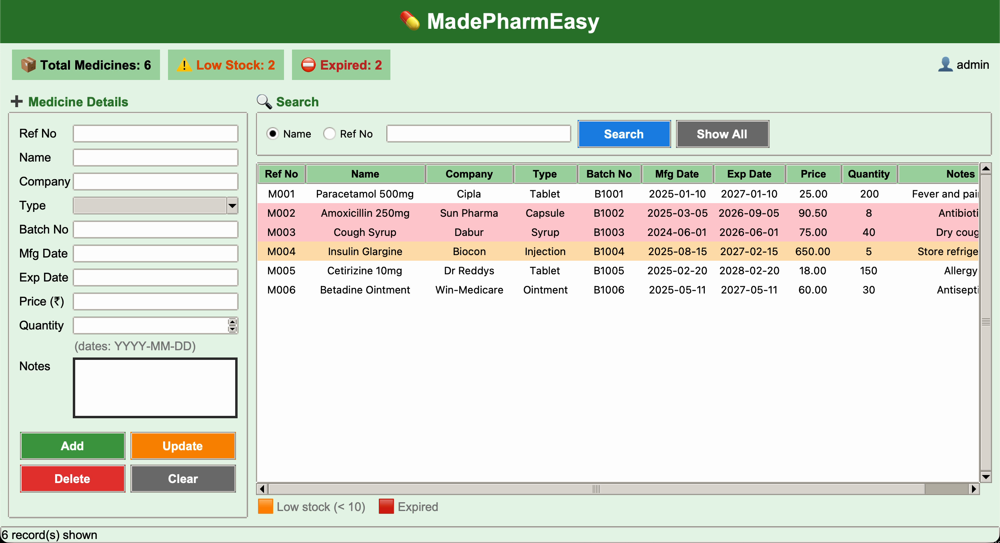
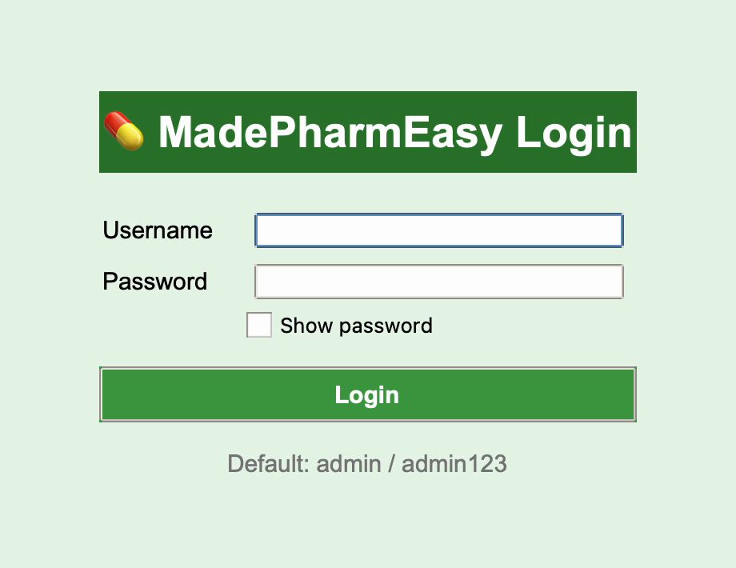

# 💊 MadePharmEasy

_Pharmacy Management System_





Desktop app to manage pharmacy medicine stock. Built with **Python, Tkinter, MySQL**.

**Features:** login, add / update / delete medicines, search by name or ref no, stock table with low-stock & expiry highlighting, stats bar, CSV export.

## Run on Windows

**One-time setup**
1. Install [Python 3](https://www.python.org/downloads/). On the first screen, tick **"Add python.exe to PATH"**.
2. Install [MySQL Server](https://dev.mysql.com/downloads/installer/) using the *MySQL Installer*. Choose **Server only**, set a **root password**, and remember it.

**Start the app.** Open **PowerShell** and run:

```powershell
git clone https://github.com/thiyatira/MadePharmEasy.git
cd MadePharmEasy
pip install -r requirements.txt
$env:DB_PASSWORD="your_mysql_root_password"
python app.py
```

> No git? Click **Code → Download ZIP** on GitHub, extract it, and open PowerShell in that folder.
> Using cmd instead of PowerShell? Write `set DB_PASSWORD=your_mysql_root_password`.

The database and sample data are created automatically from `schema.sql` on first run.

Login: **admin / admin123**
